<a href="https://febin-renu.vercel.app"><picture><source media="(prefers-color-scheme: dark)" srcset="assets/calibre/header-dark.svg"/></picture></a>

 

<picture><source media="(prefers-color-scheme: dark)" srcset="assets/calibre/dividers/i-dark.svg"/></picture>

**I build systems that decide under uncertainty, and leave a trail you can audit.**

Not "call an LLM and hope": a calibrated model, a cost function, and a defined point where a human takes over. A payment-recovery engine that's allowed to conclude the right move is doing nothing. A medical second opinion that withholds the findings it can't prove. A camera search that says "no" when the footage says no. Underneath the product work, plain full-stack engineering with tests and CI, because none of the above ships without it.

NOW&nbsp; Software Developer at Entarch Solutions (remote, since Jan 2026) · Software Engineering Intern / Dev Lead at Grids Apps LLC (remote, since Jul 2026) 
STUDY&nbsp; Final-year CS at Karunya Institute of Technology and Sciences, 2023–2027, CGPA 9.39 
EXPLORING&nbsp; conditional knowledge conflicts in retrieval (a paper in preparation), and checks a model has to pass before anyone trusts it 
OPEN TO&nbsp; full-time engineering, AI/ML and platform roles from May 2027 · [portfolio](https://febin-renu.vercel.app) · [febinrenu7@gmail.com](mailto:febinrenu7@gmail.com)

 

<picture><source media="(prefers-color-scheme: dark)" srcset="assets/calibre/dividers/ii-dark.svg"/></picture>

| Area | What's actually there | Proof |
|---|---|---|
| Decision systems | calibrated logistic regression + expected-value optimization | [Reclaim](https://github.com/febinrenu/reclaim): public, 574 tests, CI. Also the Wager below |
| Medical imaging, verified | deletion tests, temperature scaling + conformal sets, second reader, leakage audit, hash-chained audit trail | [PARALLAX](https://github.com/febinrenu/PARALLAX): public, live, hackathon team build |
| Multi-camera video | detection, tracking, cross-camera re-ID, natural-language retrieval with evidence | [EVORA](https://github.com/febinrenu/EVORA): public, live, hackathon team build, measured on MEVA and WILDTRACK |
| Legal NLP + policy simulation | statute parsing, span-grounded rule extraction, tax microsimulation | [PRISM](https://github.com/febinrenu/PRISM): public |
| RAG research | conditional knowledge conflicts: detect, scope, compose | [ScopeCompose](https://github.com/febinrenu/ScopeCompose): public, research in progress, no results to quote yet. Plus Hugging Face Agents and LangChain/LlamaIndex RAG coursework |
| Applied ML | scikit-learn, XGBoost, LSTM forecasting | [AssetStream](https://github.com/febinrenu/AssetStream), [ml-loan](https://github.com/febinrenu/ml-loan), [Bitcoin-LSTM](https://github.com/febinrenu/Bitcoin-Price-Prediction-using-LSTM): public |
| Full-stack product | Next.js/Django/Node, Postgres/Redis/MongoDB, Docker | 7 live deployments (two are static demos of local systems), listed below |
| Agentic AI / LLM orchestration | AWS Bedrock multi-agent system, confidence-based routing | current role. Real, but the code is a client's, not public |
| Cloud infra (Terraform, K8s, Helm) | full IaC pipeline with CI/CD, monitoring | PromptForge: live demo, repo not public |
| Computer vision | customer-behavior modeling project | Intel Unnati industrial training, Feb–Apr 2025. No public repo |
| Research curiosity | measuring whether prompt instability costs inference energy | [Computational Entropy Lab](https://github.com/febinrenu/comp_entropy): public |

I'd rather show you this table than let "AI Engineer" do the talking. Some of the above I can point you straight at the code for. Some of it I can't, and I'd rather say so than blur the line.

 

<picture><source media="(prefers-color-scheme: dark)" srcset="assets/calibre/dividers/iii-dark.svg"/></picture>

Each project below is drawn as the watch complication that does the same job. Every number on a plate comes from that project's own README. Where a plate is an illustration, it says so on the plate.

<a href="https://github.com/febinrenu/EVORA"><picture><source media="(prefers-color-scheme: dark)" srcset="assets/calibre/plates/01-evora-dark.svg"/></picture></a>

**[Evora](https://github.com/febinrenu/EVORA)**: ask a set of cameras a question in plain language ([live](https://evora-ivory.vercel.app)). It answers with a camera, a time, a clip with the object circled, and the reasons. When the footage doesn't support an answer, it says so and shows the nearest miss. A frame-similarity baseline matches it on plain object presence, the sets are small, and the repo says all of this. Hackathon team build.

<a href="https://github.com/febinrenu/PARALLAX"><picture><source media="(prefers-color-scheme: dark)" srcset="assets/calibre/plates/02-parallax-dark.svg"/></picture></a>

**[Parallax](https://github.com/febinrenu/PARALLAX)**: a medical second opinion that has to prove every finding before a doctor sees it ([live](https://parallax-two-xi.vercel.app)). A finding has to point at something. Blurring what it points at has to lower its confidence. It has to survive perturbation, calibration and a second reader, and every step joins a SHA-256 hash chain. The number I'd lead with is the uncomfortable one: most brain and skin findings fail the deletion test, so they're withheld rather than shown. Decision support only, not a medical device. Hackathon team build.

<a href="https://github.com/febinrenu/reclaim"><picture><source media="(prefers-color-scheme: dark)" srcset="assets/calibre/plates/03-reclaim-dark.svg"/>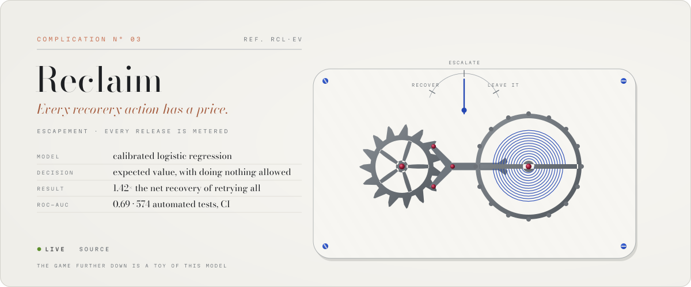</picture></a>

**[Reclaim](https://github.com/febinrenu/reclaim)**: risk-aware revenue recovery ([live](https://reclaim-lac-six.vercel.app)). Most retry logic assumes recovering a failed payment is always worth attempting. Reclaim prices each action instead, and it's free to decide the right answer is to leave it alone. TypeScript, Next.js, PostgreSQL, Razorpay, idempotent webhooks, and a human-escalation budget for the cases too risky to automate.

<a href="https://github.com/febinrenu/ScopeCompose"><picture><source media="(prefers-color-scheme: dark)" srcset="assets/calibre/plates/04-scopecompose-dark.svg"/>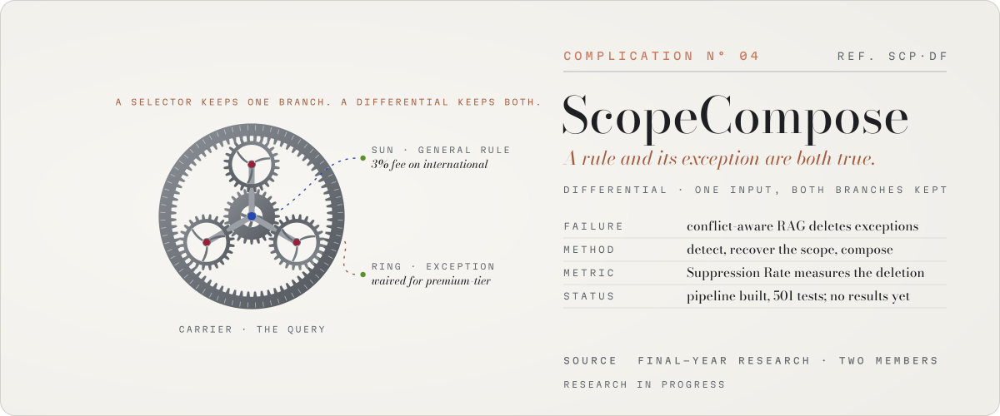</picture></a>

**[ScopeCompose](https://github.com/febinrenu/ScopeCompose)**: final-year research, two members. Conflict-aware RAG resolves disagreements by picking the more credible source. For a rule and its exception that silently deletes the exception, and answer-correctness metrics can't see the deletion. ScopeCompose composes a scoped answer that keeps every valid branch, and adds a metric for the deletion: Suppression Rate. Status, honestly: the pipeline is built, and annotation and live runs are in progress.

<a href="https://github.com/febinrenu/PRISM"><picture><source media="(prefers-color-scheme: dark)" srcset="assets/calibre/plates/05-prism-dark.svg"/></picture></a>

**[Prism](https://github.com/febinrenu/PRISM)**: when a language model extracts the rules of an Indian tax statute, does simulating those rules reach the same policy conclusions as an expert's coding of the same law? And when it doesn't, which clause is responsible? Statutes become a legal AST, rules are grounded to exact spans, and they run on a taxpayer population that reproduces the official Income Tax Return Statistics. The plate shows the kind of divergence Prism exists to trace, not a reported result.

<a href="https://github.com/febinrenu/AssetStream"><picture><source media="(prefers-color-scheme: dark)" srcset="assets/calibre/plates/06-assetstream-dark.svg"/></picture></a>

**[AssetStream](https://github.com/febinrenu/AssetStream)**: Equipment-as-a-Service for leased industrial equipment ([live](https://assetstream-frontend.onrender.com)). A Django + Celery + Redis engine turns IoT telemetry into invoices on a billing cycle. A scikit-learn model prices resale value, so the remarketing call isn't a guess. Next.js/TypeScript front end, Groq LLM integration, fully Dockerized.

<a href="https://github.com/febinrenu/comp_entropy"><picture><source media="(prefers-color-scheme: dark)" srcset="assets/calibre/plates/07-entropy-dark.svg"/>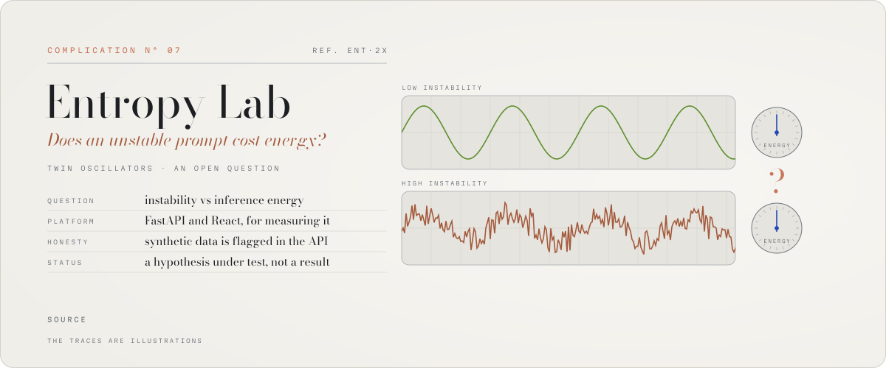</picture></a>

**[Computational Entropy Lab](https://github.com/febinrenu/comp_entropy)**: a FastAPI/React platform testing one question: does semantic instability in a prompt carry a measurable inference-energy cost? Demo data is flagged `measurement_source: synthetic_simulation` in the API, so it's never mistaken for a result. Built because the question was interesting, not because anyone asked for it.

 

<picture><source media="(prefers-color-scheme: dark)" srcset="assets/calibre/dividers/iv-dark.svg"/></picture>

**[PromptForge](https://prompt-forge-frontend.vercel.app)**: prompt discovery and testing across multiple LLMs. It runs on a 10-service NestJS architecture on a Terraform-provisioned K3s cluster with Helm, HPA autoscaling and a full CI/CD pipeline (lint → test → Docker → Trivy scan → zero-downtime deploy). The repo is private; the live app is the proof.

**AskVid-Pro**: answers free-form questions about short videos with timestamped citations. Built on a 4-bit QLoRA-fine-tuned Video-LLaMA2 with OpenCLIP/FAISS retrieval, evaluated on MSRVTT-QA and NEXT-QA, and deployed on Hugging Face Spaces. The repo is private.

**QuantroCode**: multi-tenant POS/ERP SaaS in PHP/Vue, with custom domains, pharmacy batch tracking, POS hardware integration and a client billing portal. The repo is private.

ALSO&nbsp; [BlogHaven](https://github.com/febinrenu/bloghaven), a MERN platform with role-based auth and moderation ([live](https://bloghaven-draft.netlify.app)) · [Bitcoin-LSTM](https://github.com/febinrenu/Bitcoin-Price-Prediction-using-LSTM), early ML work evaluated on MSE/RMSE, not a trading signal

 

<picture><source media="(prefers-color-scheme: dark)" srcset="assets/calibre/dividers/v-dark.svg"/></picture>

A game you can play right here. Reclaim's whole argument is that a calibrated model with a cost function makes better recovery calls than "always retry." So here's a failed payment: make the call. A toy version of Reclaim's model makes its own call on the same case, and both are scored by expected value at the true odds. Nobody wins on a lucky coin flip.

The model sees every field on the card. **It can't read the note.** That's your edge, if you use it. Press a plaque and an issue opens with your move filled in. Hit **Create**, and within about a minute a bot scores you against the model, updates this board and deals the next case.

<!-- GAME:START -->
<picture><source media="(prefers-color-scheme: dark)" srcset="assets/calibre/wager/case-dark.svg?v=2"/></picture>

<a href="https://github.com/febinrenu/febinrenu/issues/new?title=reclaim%7Crecover%7C2&body=Just%20press%20%2A%2ACreate%2A%2A%20%28or%20%2A%2ASubmit%20new%20issue%2A%2A%29.%20A%20bot%20scores%20your%20call%20against%20the%20model%20in%20about%20a%20minute%2C%20comments%20with%20the%20result%20and%20closes%20this."><picture><source media="(prefers-color-scheme: dark)" srcset="assets/calibre/wager/plaque-recover-dark.svg"/></picture></a><a href="https://github.com/febinrenu/febinrenu/issues/new?title=reclaim%7Cescalate%7C2&body=Just%20press%20%2A%2ACreate%2A%2A%20%28or%20%2A%2ASubmit%20new%20issue%2A%2A%29.%20A%20bot%20scores%20your%20call%20against%20the%20model%20in%20about%20a%20minute%2C%20comments%20with%20the%20result%20and%20closes%20this."><picture><source media="(prefers-color-scheme: dark)" srcset="assets/calibre/wager/plaque-escalate-dark.svg"/></picture></a><a href="https://github.com/febinrenu/febinrenu/issues/new?title=reclaim%7Cleave%7C2&body=Just%20press%20%2A%2ACreate%2A%2A%20%28or%20%2A%2ASubmit%20new%20issue%2A%2A%29.%20A%20bot%20scores%20your%20call%20against%20the%20model%20in%20about%20a%20minute%2C%20comments%20with%20the%20result%20and%20closes%20this."><picture><source media="(prefers-color-scheme: dark)" srcset="assets/calibre/wager/plaque-leave-dark.svg"/></picture></a>

No moves yet. The first visitor sets the scoreboard.

<!-- GAME:END -->

<b>How it's scored</b>

 

With amount **A** and true recovery probability **p**:

- **RECOVER** = p·A·(1 − c) − 0.03·A − ₹20 − (1 − p)·0.40·A. A failed retry burns goodwill. c = 0.5 when the reason is suspected fraud, because half of that money gets charged back later.
- **ESCALATE** = p′·A − 0.03·A − ₹1,200 − (1 − p′)·0.10·A, where p′ = p + 0.20·(1 − p). A human closes a fifth of the gap, catches the fraud, and costs real time.
- **LEAVE IT** = 0, on purpose.

The model's p comes from a logistic regression over the fields on the card. The true p adds the note's effect and a little noise. The model takes the best action at *its* p, then both calls are scored at the true p, and the scoreboard is the running sum.

These are synthetic cases and a toy replica of Reclaim's decision logic, not its production model. The engine is public in [`game/engine.py`](game/engine.py). Reading it to win is learning the model, which is the point.

 

<picture><source media="(prefers-color-scheme: dark)" srcset="assets/calibre/dividers/vi-dark.svg"/></picture>

<picture><source media="(prefers-color-scheme: dark)" srcset="assets/calibre/specification-dark.svg"/></picture>

 

<picture><source media="(prefers-color-scheme: dark)" srcset="assets/calibre/dividers/vii-dark.svg"/></picture>

<picture><source media="(prefers-color-scheme: dark)" srcset="assets/calibre/ledger-dark.svg"/></picture>

A snapshot from the GitHub API, redrawn every week by [an Action](.github/workflows/ledger.yml). Not live, and it counts public work only.

 

<picture><source media="(prefers-color-scheme: dark)" srcset="assets/calibre/colophon-dark.svg"/></picture>

**SMAHI-ER**, IEEE IEHNS, June 2026: a multi-agent hypergraph framework for resilient human-machine manufacturing. [10.1109/IEHNS68708.2026.11607072](https://doi.org/10.1109/IEHNS68708.2026.11607072) 
First Rank, 9.54 SGPA (May 2024) · Second Rank, 9.42 SGPA (Dec 2023), Karunya Institute

[Portfolio](https://febin-renu.vercel.app) · [GitHub](https://github.com/febinrenu) · [LinkedIn](https://www.linkedin.com/in/febin-renu/) · [febinrenu7@gmail.com](mailto:febinrenu7@gmail.com)
